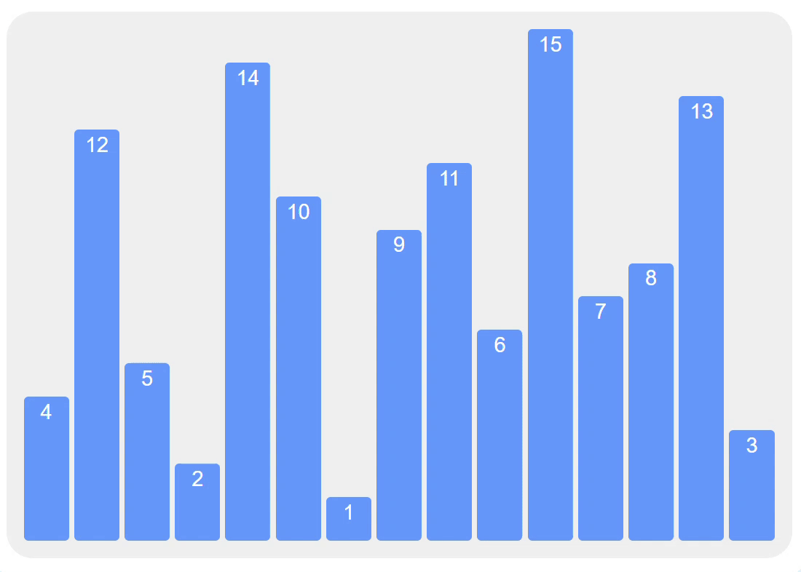

# 行列式

## 排列

### 定义

由数$1, 2, 3, \dots, n$组成的有序数组称作一个$n$阶排列,以$j_1 j_2=\dots j_n$表示.

所有$n$阶排列的数量为$A_{n}^{n}=n!$个.

完全正序的排列$1 2\dots n$称为自然排列.

### 逆序数

对于一个排列中的某两个数,如果靠前的数比靠后的数大,则称这两个数构成一个逆序.一个排列$j_1 j_2 \dots j_n$中所有逆序的数量称作这个排列的逆序数,记为$\tau(j_1 j_2 \dots j_n)$.

一个$n$阶的完全逆序排列$n(n-1)\dots1$的逆序数为$\displaystyle 1+2+\dots +(n-1)=\frac{n(n-1)}{2}$.

逆序数为偶数的排列称作偶排列,逆序数为奇数的排列称作奇排列.

### 性质

#### 对换

在排列中交换某两个数而保持其他数不变的操作称为对换.

一次对换会改变排列的奇偶性,即会使偶排列变成奇排列,奇排列变成偶排列.

> 证明:先考虑最简单的情况,对相邻位置的数进行对换.设$j_1 j_2 \dots j_n$为一个排列,交换它的第$p$项和第$p+1$项$(p=1,2,\dots,n-1)$,即
>
> $$
> j_1 \dots j_p j_{p+1} \dots j_n \xrightarrow{对换j_p,j_{p+1}} j_1 \dots j_{p+1} j_{p} \dots j_n
> $$
>
> 显然,对于排列中除了这两个数之外的其他数,它们的逆序数不变;而对于$j_p$和$j_{p+1}$,如果$j_p < j_{p+1}$,则交换后逆序数减$1$;如果$j_p > j_{p+1}$,则交换后逆序数加$1$.无论如何,逆序数的变化总是奇数.
>
> 再考虑稍微复杂些的情况,对非相邻位置的数进行对换..设$j_1 j_2 \dots j_n$为一个排列,交换它的第$p$项和第$q$项$(p,q \in \N^\star且1\le p<q \le n)$,即
>
> $$
> j_1 \dots j_p \dots j_q \dots j_n \xrightarrow{对换j_p,j_q} j_1 \dots j_q \dots j_p \dots j_n
> $$
>
> 这等价于进行如下一系列相邻数对换操作:
>
> $$
> \begin{align}
>   & j_1 \dots j_p j_{p+1} j_{p+2} \dots j_{q-2} j_{q-1} j_q \dots j_n \\
>   \xrightarrow{对换j_p,j_{p+1}} & j_1 \dots j_{p+1} j_p j_{p+2} \dots j_{q-2} j_{q-1} j_q \dots j_n \\
>   \xrightarrow{对换j_p,j_{p+2}} & j_1 \dots j_{p+1} j_{p+2} j_p \dots j_{q-2} j_{q-1} j_q \dots j_n \\
>   & \dots \dots \\
>   \xrightarrow{对换j_p,j_{q-1}} & j_1 \dots j_{p+1} j_{p+2} j_{p+3} \dots j_{q-1} j_p j_q \dots j_n \\
>   \xrightarrow{对换j_p,j_q} & j_1 \dots j_{p+1} j_{p+2} j_{p+3} \dots j_{q-1} j_q j_p \dots j_n \\
>   \xrightarrow{对换j_{q-1},j_q} & j_1 \dots j_{p+1} j_{p+2} j_{p+3} \dots j_q j_{q-1} j_p \dots j_n \\
>   & \dots \dots \\
>   \xrightarrow{对换j_{p+2},j_q} & j_1 \dots j_{p+1} j_q j_{p+2} \dots j_{q-2} j_{q-1} j_p \dots j_n \\
>   \xrightarrow{对换j_{p+1},j_q} & j_1 \dots j_q j_{p+1} j_{p+2} \dots j_{q-2} j_{q-1} j_p \dots j_n
> \end{align}
> $$
>
> 总计进行了$2(q-p)-1$次相邻数对换操作,操作次数总是奇数,故可知逆序数的变化也总是奇数.
>
> 综上,对任意位置的两个数进行一次对换,逆序数的变化总是奇数,故能使排列的奇偶性发生改变.

任意一个排列都可以通过一系列的对换变成自然排列,且对换次数的奇偶性与该排列的奇偶性相同.

> 证明:这里可以用一个经典的算法——冒泡排序来说明.
>
> ```python
> def bubble(arr: list[int]) -> list[int]:
> 	n = len(arr)
> 	for i in range(n - 1):
>   	has_swapped = False
>   	for j in range(n - 1 - i):
>       	if arr[j] > arr[j + 1]:
>           	# 这一步就是在顺序不对时进行对换.
>           	arr[j], arr[j + 1] = arr[j + 1], arr[j]
>           	has_swapped = True
>   	if not has_swapped:
>       	# 如果已经有序了,就提前结束.
>       	break
> ```
>
> 看不懂python代码的可以看看下面这张动图
>
> 
>
> 上述算法就是通过对相邻交换来实现的排序,并且每个数在被指针j指到时发生的对换次数恰好是该数"往后数小"的逆序数,这也就意味着整个排序算法的对换次数就等于这个排列的逆序数.
>
> 对于任意一个排列,对换偶数次得到的排列奇偶性相同,对换奇数次得到的排列奇偶性不同.由于自然排列的逆序数为0,即自然排列是偶排列,故从一个偶排列变成自然排列(或反之)需要进行偶数次对换,从一个奇排列变成自然排列(或反之)需要进行奇数次对换,故对换次数的奇偶性与该排列的奇偶性相同.

#### 奇偶排列数量相同

所有的$n$阶排列$(n \ge 2)$中,偶排列与奇排列各占一半,也就是$\displaystyle \frac{n!}{2}$个.

> 证明:注意到对换第一个数和第二个数的操作能够使偶排列与奇排列一一对应,故偶排列与奇排列的数量相等.

## 行列式的定义

$n$阶行列式是用一个$n \times n$的方阵表示的一个数,其值的计算方式为:

$$
\begin{align}
\begin{vmatrix}
a_{1,1} & a_{1,2} & \cdots & a_{1,n} \\
a_{2,1} & a_{2,2} & \cdots & a_{2,n} \\
\vdots & \vdots & \ddots & \vdots \\
a_{n,1} & a_{n,2} & \cdots & a_{n,n}
\end{vmatrix}
&=\sum_{j_1 j_2 \dots j_n}{(-1)^{\tau(j_1 j_2 \dots j_n)} \prod_{i=1}^{n}a_{i,j_i}} \\
&=\sum_{j_1 j_2 \dots j_n}{(-1)^{\tau(j_1 j_2 \dots j_n)} a_{1,j_1} a_{2,j_2} \dots a_{n,j_n}}
\end{align}
$$

由于对每一项同时进行行和列的排列的对换时,对换数为2,为偶数,故不改变行和列的排列的总逆序数的奇偶性.故也可以这样计算:

$$
\begin{align}
\begin{vmatrix}
a_{1,1} & a_{1,2} & \cdots & a_{1,n} \\
a_{2,1} & a_{2,2} & \cdots & a_{2,n} \\
\vdots & \vdots & \ddots & \vdots \\
a_{n,1} & a_{n,2} & \cdots & a_{n,n}
\end{vmatrix}
&=\sum_{j_1 j_2 \dots j_n}{(-1)^{\tau(i_1 i_2 \dots i_n)+\tau(j_1 j_2 \dots j_n)} \prod_{k=1}^{n}a_{i_k,j_k}} \\
&=\sum_{j_1 j_2 \dots j_n}{(-1)^{\tau(i_1 i_2 \dots i_n)+\tau(j_1 j_2 \dots j_n)} a_{i_1,j_1} a_{i_2,j_2} \dots a_{i_n,j_n}}
\end{align}
$$

如果$j_1 j_2 \dots j_n=12 \dots n$,则:

$$
\begin{align}
\begin{vmatrix}
a_{1,1} & a_{1,2} & \cdots & a_{1,n} \\
a_{2,1} & a_{2,2} & \cdots & a_{2,n} \\
\vdots & \vdots & \ddots & \vdots \\
a_{n,1} & a_{n,2} & \cdots & a_{n,n}
\end{vmatrix}
&=\sum_{i_1 i_2 \dots i_n}{(-1)^{\tau(i_1 i_2 \dots i_n)} \prod_{j=1}^{n}a_{i_j,j}} \\
&=\sum_{i_1 i_2 \dots i_n}{(-1)^{\tau(i_1 i_2 \dots i_n)} a_{i_1,1} a_{i_2,2} \dots a_{i_n,n}}
\end{align}
$$

这也说明了行列式的行和列是完全等价的.

## 行列式的性质

### 转置不变(行列等价)

转置后不改变行列式的值(即行列式的行和列是完全等价)

$$
\begin{vmatrix}
a_{1,1} & a_{1,2} & \cdots & a_{1,n} \\
a_{2,1} & a_{2,2} & \cdots & a_{2,n} \\
\vdots & \vdots & \ddots & \vdots \\
a_{n,1} & a_{n,2} & \cdots & a_{n,n}
\end{vmatrix}
=
\begin{vmatrix}
a_{1,1} & a_{2,1} & \cdots & a_{n,1} \\
a_{1,2} & a_{2,2} & \cdots & a_{n,2} \\
\vdots & \vdots & \ddots & \vdots \\
a_{1,n} & a_{1,n} & \cdots & a_{n,n}
\end{vmatrix}
$$

> 证明:由定义处行列式的不同计算方式可显然得到.

### 倍乘可提

对行列式的某一行(或列)的所有元素同乘一个数等于对行列式的值乘这个数.

(以行倍乘为例)

$$
\begin{vmatrix}
a_{1,1} & a_{1,2} & \cdots & a_{1,n} \\
\vdots & \vdots & \ddots & \vdots \\
ka_{p,1} & ka_{p,2} & \cdots & ka_{p,n} \\
\vdots & \vdots & \iddots & \vdots \\
a_{n,1} & a_{n,2} & \cdots & a_{n,n}
\end{vmatrix}
= k
\begin{vmatrix}
a_{1,1} & a_{1,2} & \cdots & a_{1,n} \\
\vdots & \vdots & \ddots & \vdots \\
a_{p,1} & a_{p,2} & \cdots & a_{p,n} \\
\vdots & \vdots & \iddots & \vdots \\
a_{n,1} & a_{n,2} & \cdots & a_{n,n}
\end{vmatrix}
$$

> 证明:
>
> $$
> \begin{align}
> \mathrm{LHS}
> &=\sum_{j_1 j_2 \dots j_n}{(-1)^{\tau(j_1 j_2 \dots j_n)} a_{1,j_1} \dots ka_{p,j_p} \dots a_{n,j_n}} \\
> &=k \sum_{j_1 j_2 \dots j_n}{(-1)^{\tau(j_1 j_2 \dots j_n)} a_{1,j_1} \dots a_{p,j_p} \dots a_{n,j_n}} \\
> &=\mathrm{RHS}
> \end{align}
> $$

衍生:如果一个行列式的某一行(或列)全为0,则行列式的值为0.

(以一行全为0为例)

$$
\begin{vmatrix}
a_{1,1} & a_{1,2} & \cdots & a_{1,n} \\
\vdots & \vdots & \ddots & \vdots \\
0 & 0 & \cdots & 0 \\
\vdots & \vdots & \iddots & \vdots \\
a_{n,1} & a_{n,2} & \cdots & a_{n,n}
\end{vmatrix}
= 0
$$

### 一行(或列)可拆项

将一个行列式的某一行(或列)的每个元素拆分成两个数,则这个行列式的值等于将该行的每个元素分别替换为拆分出的两个数得到的两个行列式之和.

(以拆行为例)

$$
\begin{vmatrix}
a_{1,1} & a_{1,2} & \cdots & a_{1,n} \\
\vdots & \vdots & \ddots & \vdots \\
a_{p,1}+a_{p,1}' & a_{p,2}+a_{p,2}' & \cdots & a_{p,n}+a_{p,n}' \\
\vdots & \vdots & \iddots & \vdots \\
a_{n,1} & a_{n,2} & \cdots & a_{n,n}
\end{vmatrix} \\
=
\begin{vmatrix}
a_{1,1} & a_{1,2} & \cdots & a_{1,n} \\
\vdots & \vdots & \ddots & \vdots \\
a_{p,1} & a_{p,2} & \cdots & a_{p,n} \\
\vdots & \vdots & \iddots & \vdots \\
a_{n,1} & a_{n,2} & \cdots & a_{n,n}
\end{vmatrix}
+
\begin{vmatrix}
a_{1,1} & a_{1,2} & \cdots & a_{1,n} \\
\vdots & \vdots & \ddots & \vdots \\
a_{p,1}' & a_{p,2}' & \cdots & a_{p,n}' \\
\vdots & \vdots & \iddots & \vdots \\
a_{n,1} & a_{n,2} & \cdots & a_{n,n}
\end{vmatrix}
$$

> 证明:
>
> $$
> \begin{align}
> \mathrm{LHS}
> &=\sum_{j_1 j_2 \dots j_n}{(-1)^{\tau(j_1 j_2 \dots j_n)} a_{1,j_1} \dots (a_{p,j_p}+a_{p,j_p}') \dots a_{n,j_n}} \\
> &=\sum_{j_1 j_2 \dots j_n}{(-1)^{\tau(j_1 j_2 \dots j_n)} a_{1,j_1} \dots a_{p,j_p} \dots a_{n,j_n}}
>+\sum_{j_1 j_2 \dots j_n}{(-1)^{\tau(j_1 j_2 \dots j_n)} a_{1,j_1} \dots a_{p,j_p}' \dots a_{n,j_n}}\\
> &=\mathrm{RHS}
> \end{align}
> $$

### 对换取反

对换行列式的某两行(或列),行列式的值变为原来的相反数.

(以对换行为例)
$$
\begin{vmatrix}
a_{1,1} & a_{1,2} & \cdots & a_{1,n} \\
\vdots & \vdots & \ddots & \vdots \\
a_{p,1} & a_{p,2} & \cdots & a_{p,n} \\
\vdots & \vdots & \vdots & \vdots \\
a_{q,1} & a_{q,2} & \cdots & a_{q,n} \\
\vdots & \vdots & \iddots & \vdots \\
a_{n,1} & a_{n,2} & \cdots & a_{n,n}
\end{vmatrix}
= -
\begin{vmatrix}
a_{1,1} & a_{1,2} & \cdots & a_{1,n} \\
\vdots & \vdots & \ddots & \vdots \\
a_{q,1} & a_{q,2} & \cdots & a_{q,n} \\
\vdots & \vdots & \vdots & \vdots \\
a_{p,1} & a_{p,2} & \cdots & a_{p,n} \\
\vdots & \vdots & \iddots & \vdots \\
a_{n,1} & a_{n,2} & \cdots & a_{n,n}
\end{vmatrix}
$$

> 证明:
> $$
> \begin{align}
> \mathrm{LHS}
> &=\sum_{j_1 j_2 \dots j_n}{(-1)^{\tau(j_1 \dots j_p \dots j_q \dots j_n)} a_{1,j_1} \dots a_{p,j_p}\dots a_{q,j_q} \dots a_{n,j_n}} \\
> &=\sum_{j_1 j_2 \dots j_n}{(-1)^{\tau(j_1 \dots j_p \dots j_q \dots j_n)} a_{1,j_1} \dots a_{q,j_q}\dots a_{p,j_p} \dots a_{n,j_n}} \\
> &=-\sum_{j_1 j_2 \dots j_n}{(-1)^{\tau(j_1 \dots j_q \dots j_p \dots j_n)} a_{1,j_1} \dots a_{q,j_q}\dots a_{p,j_p} \dots a_{n,j_n}} \\
> &=\mathrm{RHS}
> \end{align}
> $$

### 行(或列)成比取零

如果一个行列式的某两行(或列)的所有元素对应成比列,则行列式的值为$0$.

(以同行为例)
$$
\begin{vmatrix}
a_{1,1} & a_{1,2} & \cdots & a_{1,n} \\
\vdots & \vdots & \ddots & \vdots \\
a_{p,1} & a_{p,2} & \cdots & a_{p,n} \\
\vdots & \vdots & \vdots & \vdots \\
ka_{p,1} & ka_{p,2} & \cdots & ka_{p,n} \\
\vdots & \vdots & \iddots & \vdots \\
a_{n,1} & a_{n,2} & \cdots & a_{n,n}
\end{vmatrix}
= 0
$$

> 证明:当$k=1$时,两行完全相同,此时交换这两行得到:
> $$
> \begin{align}
> & \begin{vmatrix}
> a_{1,1} & a_{1,2} & \cdots & a_{1,n} \\
> \vdots & \vdots & \ddots & \vdots \\
> a_{p,1} & a_{p,2} & \cdots & a_{p,n} \\
> \vdots & \vdots & \vdots & \vdots \\
> a_{p,1} & a_{p,2} & \cdots & a_{p,n} \\
> \vdots & \vdots & \iddots & \vdots \\
> a_{n,1} & a_{n,2} & \cdots & a_{n,n}
> \end{vmatrix}
>=-
> \begin{vmatrix}
> a_{1,1} & a_{1,2} & \cdots & a_{1,n} \\
> \vdots & \vdots & \ddots & \vdots \\
> a_{p,1} & a_{p,2} & \cdots & a_{p,n} \\
> \vdots & \vdots & \vdots & \vdots \\
> a_{p,1} & a_{p,2} & \cdots & a_{p,n} \\
> \vdots & \vdots & \iddots & \vdots \\
> a_{n,1} & a_{n,2} & \cdots & a_{n,n}
> \end{vmatrix} \\
> \Rightarrow & 
> \begin{vmatrix}
> a_{1,1} & a_{1,2} & \cdots & a_{1,n} \\
> \vdots & \vdots & \ddots & \vdots \\
> a_{p,1} & a_{p,2} & \cdots & a_{p,n} \\
> \vdots & \vdots & \vdots & \vdots \\
> a_{p,1} & a_{p,2} & \cdots & a_{p,n} \\
> \vdots & \vdots & \iddots & \vdots \\
> a_{n,1} & a_{n,2} & \cdots & a_{n,n}
> \end{vmatrix}
>=0
> \end{align}
> $$
>
> 从而对于一般的$k$,有:
>
> $$
> \begin{align}
> \begin{vmatrix}
> a_{1,1} & a_{1,2} & \cdots & a_{1,n} \\
> \vdots & \vdots & \ddots & \vdots \\
> a_{p,1} & a_{p,2} & \cdots & a_{p,n} \\
> \vdots & \vdots & \vdots & \vdots \\
> ka_{p,1} & ka_{p,2} & \cdots & ka_{p,n} \\
> \vdots & \vdots & \iddots & \vdots \\
> a_{n,1} & a_{n,2} & \cdots & a_{n,n}
> \end{vmatrix}
> &=k
> \begin{vmatrix}
> a_{1,1} & a_{1,2} & \cdots & a_{1,n} \\
> \vdots & \vdots & \ddots & \vdots \\
> a_{p,1} & a_{p,2} & \cdots & a_{p,n} \\
> \vdots & \vdots & \vdots & \vdots \\
> a_{p,1} & a_{p,2} & \cdots & a_{p,n} \\
> \vdots & \vdots & \iddots & \vdots \\
> a_{n,1} & a_{n,2} & \cdots & a_{n,n}
> \end{vmatrix}
>=k \cdot 0=0
> \end{align}
> $$
>

### 倍加不变

将行列式的某一行(或列)的所有元素乘以某个倍数后加到另外一行(或列)的所有元素上,行列式的值不变.

(以行倍加为例)
$$
\begin{vmatrix}
a_{1,1} & a_{1,2} & \cdots & a_{1,n} \\
\vdots & \vdots & \ddots & \vdots \\
a_{p,1} & a_{p,2} & \cdots & a_{p,n} \\
\vdots & \vdots & \vdots & \vdots \\
a_{q,1}+ka_{p,1} & a_{q,2}+ka_{p,2} & \cdots & a_{q,n}+ka_{p,n} \\
\vdots & \vdots & \iddots & \vdots \\
a_{n,1} & a_{n,2} & \cdots & a_{n,n}
\end{vmatrix}
=
\begin{vmatrix}
a_{1,1} & a_{1,2} & \cdots & a_{1,n} \\
\vdots & \vdots & \ddots & \vdots \\
a_{p,1} & a_{p,2} & \cdots & a_{p,n} \\
\vdots & \vdots & \vdots & \vdots \\
a_{q,1} & a_{q,2} & \cdots & a_{q,n} \\
\vdots & \vdots & \iddots & \vdots \\
a_{n,1} & a_{n,2} & \cdots & a_{n,n}
\end{vmatrix}
$$

> 证明:
> $$
> \begin{align}
> \mathrm{LHS}
>=& \begin{vmatrix}
> a_{1,1} & a_{1,2} & \cdots & a_{1,n} \\
> \vdots & \vdots & \ddots & \vdots \\
> a_{p,1} & a_{p,2} & \cdots & a_{p,n} \\
> \vdots & \vdots & \vdots & \vdots \\
> a_{q,1} & a_{q,2} & \cdots & a_{q,n} \\
> \vdots & \vdots & \iddots & \vdots \\
> a_{n,1} & a_{n,2} & \cdots & a_{n,n}
> \end{vmatrix}
> +
> \begin{vmatrix}
> a_{1,1} & a_{1,2} & \cdots & a_{1,n} \\
> \vdots & \vdots & \ddots & \vdots \\
> a_{p,1} & a_{p,2} & \cdots & a_{p,n} \\
> \vdots & \vdots & \vdots & \vdots \\
> ka_{p,1} & ka_{p,2} & \cdots & ka_{p,n} \\
> \vdots & \vdots & \iddots & \vdots \\
> a_{n,1} & a_{n,2} & \cdots & a_{n,n}
> \end{vmatrix}\\
>=&
> \begin{vmatrix}
> a_{1,1} & a_{1,2} & \cdots & a_{1,n} \\
> \vdots & \vdots & \ddots & \vdots \\
> a_{p,1} & a_{p,2} & \cdots & a_{p,n} \\
> \vdots & \vdots &\vdots & \vdots \\
> a_{q,1} & a_{q,2} & \cdots & a_{q,n} \\
> \vdots & \vdots & \iddots & \vdots \\
> a_{n,1} & a_{n,2} & \cdots & a_{n,n}
> \end{vmatrix}
>+0
>=\mathrm{RHS}
> \end{align}
> $$


## 拉普拉斯(Laplace)展开定理

### 第一定理——单行(或列)展开

对$n$阶行列式$D$中第$i$行第$j$列的元素$a_{i,j}$有:

子式:即为$a_{i,j}$.

余子式:$D$删去第$i$行第$j$列后剩余的$(n-1)$阶行列式.

代数余子式:余子式加上$a_{i,j}$对应的符号$(-1)^{i+j}$,记为$A_{i,j}$,即:
$$
A_{i,j} := (-1)^{i+j}
\begin{vmatrix}
a_{1,1} & \cdots & a_{1,j-1} & a_{1,j+1} & \cdots & a_{1,n} \\
\vdots & \ddots & \vdots & \vdots & \iddots & \vdots \\
a_{i-1,1} & \cdots & a_{i-1,j-1} & a_{i-1,j+1} & \cdots & a_{i-1,n} \\
a_{i+1,1} & \cdots & a_{i+1,j-1} & a_{i+1,j+1} & \cdots & a_{i+1,n} \\
\vdots & \iddots & \vdots & \vdots & \ddots & \vdots \\
a_{n,1} & \cdots & a_{n,j-1} & a_{n,j+1} & \cdots & a_{n,n} \\
\end{vmatrix}
$$


行列式可以按照某一行(或列)展开成该行上的每个元素和它对应的代数余子式的乘积之和.

(以按第$i$行展开为例)$\displaystyle D=\sum_{j=1}^{n}{a_{i,j}A_{i,j}}$.

使用例:
$$
\begin{align}
\begin{vmatrix}
3 & 6 & 2 \\
-4 & 1 & 5 \\
0 & 2 & -3
\end{vmatrix}
\xlongequal{按r_1展开} &
3 \cdot \begin{vmatrix} 1 & 5 \\ 2 & -3 \end{vmatrix}
- 6 \cdot \begin{vmatrix} -4 & 5 \\ 0 & -3 \end{vmatrix}
+ 2 \cdot \begin{vmatrix} -4 & 1 \\ 0 & 2 \end{vmatrix} \\
= & 3 \cdot (-13)-6 \cdot 12+2 \cdot (-8)=-127
\end{align}
$$

### \*第二定理——多行(或列)展开

对$n$阶行列式$D$中第$i_1,i_2,\dots i_k$行$(i_1 < i_2 < \dots < i_k)$和第$j_1,j_2,\dots j_k$列$(j_1 < j_2 < \dots < j_k)$有:

子式:由这些行和列共同含有的元素组成的行列式,记为$M_{i_1 i_2 \dots i_k}^{j_1 j_2 \dots j_k}$,即:
$$
M_{i_1 i_2 \dots i_k}^{j_1 j_2 \dots j_k} :=
\begin{vmatrix}
a_{i_1,j_1} & a_{i_1,j_2} & \cdots & a_{i_1,j_k} \\
a_{i_2,j_1} & a_{i_2,j_2} & \cdots & a_{i_2,j_k} \\
\vdots & \vdots & \ddots & \vdots \\
a_{i_k,j_1} & a_{i_k,j_2} & \cdots & a_{i_k,j_k}
\end{vmatrix}
$$
余子式:$D$删去这$k$个行和这$k$个列后剩余的$(n-1)$阶行列式

代数余子式:余子式加上这$k$个行和这$k$个列对应的符号$(-1)^{\sum{(i+j)}}$,记为$A_{i_1 i_2 \dots i_n}^{j_1 j_2 \dots j_n}$,即:
$$
A_{i_1 i_2 \dots i_n}^{j_1 j_2 \dots j_n} := (-1)^{\sum_{t=1}^{k}{(i_t+j_t)}}
\begin{vmatrix}
a_{1,1} & \cdots & a_{1,j_1-1} & a_{1,j_1+1} & \cdots & \cdots & a_{1,j_k-1} & a_{1,j_k+1} & \cdots & a_{1,n} \\
\vdots & \ddots & \vdots & \vdots & \vdots & \vdots & \vdots & \vdots & \iddots & \vdots\\
a_{i_1-1,1} & \cdots & a_{i_1-1,j_1-1} & a_{i_1-1,j_1+1} & \cdots & \cdots & a_{i_1-1,j_k-1} & a_{i_1-1,j_k+1} & \cdots & a_{i_1-1,n} \\
a_{i_1+1,1} & \cdots & a_{i_1+1,j_1-1} & a_{i_1+1,j_1+1} & \cdots & \cdots & a_{i_1+1,j_k-1} & a_{i_1+1,j_k+1} & \cdots & a_{i_1+1,n} \\
\vdots & \cdots & \vdots & \vdots & \ddots & \iddots & \vdots & \vdots & \cdots & \vdots \\
\vdots & \cdots & \vdots & \vdots & \iddots & \ddots & \vdots & \vdots & \cdots & \vdots \\
a_{i_k-1,1} & \cdots & a_{i_k-1,j_1-1} & a_{i_k-1,j_1+1} & \cdots & \cdots & a_{i_k-1,j_k-1} & a_{i_k-1,j_k+1} & \cdots & a_{i_k-1,n} \\
a_{i_k+1,1} & \cdots & a_{i_k+1,j_1-1} & a_{i_k+1,j_1+1} & \cdots & \cdots & a_{i_k+1,j_k-1} & a_{i_k+1,j_k+1} & \cdots & a_{i_k+1,n} \\
\vdots & \iddots & \vdots & \vdots & \vdots & \vdots & \vdots & \vdots & \ddots & \vdots\\
a_{n,1} & \cdots & a_{n,j_1-1} & a_{n,j_1+1} & \cdots & \cdots & a_{n,j_k-1} & a_{n,j_k+1} & \cdots & a_{n,n}
\end{vmatrix}
$$
行列式可以按照某几行(或列)展开成这些行和所有相等数量的列组合对应的子式和代数余子式的乘积之和.

(以按第$i_1,i_2,\dots,i_k$行展开为例):$\displaystyle D=\sum_{j_1 j_2 \dots j_k}{M_{i_1 i_2 \dots i_k}^{j_1 j_2 \dots j_k}A_{i_1 i_2 \dots i_n}^{j_1 j_2 \dots j_n}}$.

使用例:
$$
\begin{align}
\begin{vmatrix}
4 & -2 & 1 & 2 \\
-1 & 5 & 0 & -3 \\
0 & -2 & 3 & 1 \\
1 & 6 & 1 & -4
\end{vmatrix}
\xlongequal{按r_1,r_3展开}
& - \begin{vmatrix} 4 & -2 \\ 0 & -2 \end{vmatrix}
\begin{vmatrix} 0 & -3 \\ 1 & -4 \end{vmatrix}
+ \begin{vmatrix} 4 & 1 \\ 0 & 3 \end{vmatrix}
\begin{vmatrix} 5 & -3 \\ 6 & -4 \end{vmatrix}
- \begin{vmatrix} 4 & 2 \\ 0 & 1 \end{vmatrix}
\begin{vmatrix} 5 & 0 \\ 6 & 1 \end{vmatrix} \\
& - \begin{vmatrix} -2 & 1 \\ -2 & 3 \end{vmatrix}
\begin{vmatrix} -1 & -3 \\ 1 & -4 \end{vmatrix}
+ \begin{vmatrix} -2 & 2 \\ -2 & 1 \end{vmatrix}
\begin{vmatrix} -1 & 0 \\ 1 & 1 \end{vmatrix}
- \begin{vmatrix} 1 & 2 \\ 3 & 1 \end{vmatrix}
\begin{vmatrix} -1 & 5 \\ 1 & 6 \end{vmatrix} \\
= & -(-8) \cdot 3+12 \cdot (-2)-4 \cdot 5 \\
&-(-4) \cdot 7+2 \cdot (-1)-(-5) \cdot (-11) \\
= & -49
\end{align}
$$


## 特殊类型的行列式计算

### 二阶行列式

$$
\begin{vmatrix}
a & b \\
c & d
\end{vmatrix}
= ad-bc
$$

### 三阶行列式

$$
\begin{vmatrix}
a_{11} & a_{12} & a_{13} \\
a_{21} & a_{22} & a_{23} \\
a_{31} & a_{32} & a_{33}
\end{vmatrix}
= a_{11}a_{22}a_{33}+a_{12}a_{23}a_{31}+a_{13}a_{21}a_{32}-a_{13}a_{22}a_{31}-a_{11}a_{23}a_{32}-a_{12}a_{21}a_{33}
$$

即有**对角线法则**:


(红色的线对应的三个数乘积带正号,蓝色的线对应的三个数乘积带负号)

### 对角线行列式

只有主对角线上有非零元素的行列式称为对角线行列式.
$$
\begin{vmatrix}
a_{1,1} & 0 & \cdots & 0 \\
0 & a_{2,2} & \cdots & 0 \\
\vdots & \vdots & \ddots & \vdots \\
0 & 0 & \cdots & a_{n,n}
\end{vmatrix}
= \prod_{k=1}^{n}a_{k,k}=a_{1,1} a_{2,2} \dots a_{n,n}
$$
特殊地,主对角线上全为1的对角线行列式称为**单位行列式**
$$
\begin{vmatrix}
1 & 0 & \cdots & 0 \\
0 & 1 & \cdots & 0 \\
\vdots & \vdots & \ddots & \vdots \\
0 & 0 & \cdots & 1
\end{vmatrix}
= 1
$$


### 上三角(或下三角)行列式

主对角线以下的元素全为0的行列式称为上三角行列式;主对角线以上的元素全为0的行列式称为下三角行列式.
$$
\begin{vmatrix}
a_{1,1} & a_{1,2} & \cdots & a_{1,n} \\
0 & a_{2,2} & \cdots & a_{2,n} \\
\vdots & \vdots & \ddots & \vdots \\
0 & 0 & \cdots & a_{n,n}
\end{vmatrix}
= 
\begin{vmatrix}
a_{1,1} & 0 & \cdots & 0 \\
a_{2,1} & a_{2,2} & \cdots & 0 \\
\vdots & \vdots & \ddots & \vdots \\
a_{n,1} & a_{n,2} & \cdots & a_{n,n}
\end{vmatrix}
=\prod_{k=1}^{n}a_{k,k}=a_{1,1} a_{2,2} \dots a_{n,n}
$$

> 证明:以上三角行列式为例.对于1阶的上三角行列式,显然$|a_{11}|=a_{11}$.(注意这不是绝对值符号)
>
> 假设对于$m$阶的上三角行列式上述等式成立,即有:
> $$
> \begin{vmatrix}
> a_{1,1} & a_{1,2} & \cdots & a_{1,m} \\
> 0 & a_{2,2} & \cdots & a_{2,m} \\
> \vdots & \vdots & \ddots & \vdots \\
> 0 & 0 & \cdots & a_{m,m}
> \end{vmatrix}_{\tiny m \times m}
>=\prod_{k=1}^{m}a_{k,k}
> $$
> 则对于$m+1$阶的上三角行列式,有:
> $$
> \begin{align}
> \begin{vmatrix}
> a_{1,1} & a_{1,2} & \cdots & a_{1,m+1} \\
> 0 & a_{2,2} & \cdots & a_{2,m+1} \\
> \vdots & \vdots & \ddots & \vdots \\
> 0 & 0 & \cdots & a_{m+1,m+1} 
> \end{vmatrix}_{\tiny (m+1) \times (m+1)}
> \xlongequal{按r_{m+1}展开} \  & a_{m+1,m+1}
> \begin{vmatrix}
> a_{1,1} & a_{1,2} & \cdots & a_{1,m} \\
> 0 & a_{2,2} & \cdots & a_{2,m} \\
> \vdots & \vdots & \ddots & \vdots \\
> 0 & 0 & \cdots & a_{m,m}
> \end{vmatrix}_{\tiny m \times m} \\
>=\  & a_{m+1,m+1}\prod_{k=1}^{m}{a_{k,k}}=\prod_{k=1}^{m+1}a_{k,k}
> \end{align}
> $$
> 综上,由数学归纳法可知,上述等式成立.

> [!Note]
>
> 也可以这样理解:上三角行列式往往可以通过倍加操作消去其他元素,从而变换成对角线行列式并且保持对角线上的值不变,故计算方式和对角线行列式相同.
>
> 然而还需强调,如果对角线上有元素为0,则可能出现该元素同行或同列的某个元素消不掉的情况.比如下面这个上三角行列式,在对角线上的某处有一个元素为0.
>
> 
> 
> 这时出现了一个矩形的全为0的区域.由于这个区域的范围足够大,故行列式的值为0.

### 反对角线行列式,反上三角(或下三角)行列式

只有副对角线上有非零元素的行列式称为反对角线行列式.由于$n$阶的完全逆序排列$n(n-1)\dots1$的逆序数为$\displaystyle \frac{n(n-1)}{2}$,故:
$$
\begin{vmatrix}
0 & \cdots & 0 & a_{1,n} \\
0 & \cdots & a_{2,n-1} & 0 \\
\vdots & \iddots & \vdots & \vdots \\
a_{n,1} & \cdots & 0 & 0
\end{vmatrix}
=(-1)^{\frac{n(n-1)}{2}}\prod_{k=1}^{n}{a_{k,n + 1 - k}}=(-1)^{\frac{n(n-1)}{2}}a_{1,n} a_{2,n-1} \dots a_{n,1}
$$

副对角线以下的元素全为0的行列式称为上三角行列式;副对角线以上的元素全为0的行列式称为下三角行列式.同理有:
$$
\begin{vmatrix}
a_{1,1} & \cdots & a_{1,n-1} & a_{1,n} \\
a_{2,1} & \cdots & a_{2,n-1} & 0 \\
\vdots & \iddots & \vdots & \vdots \\
a_{n,1} & \cdots & 0 & 0
\end{vmatrix}
=
\begin{vmatrix}
0 & \cdots & 0 & a_{1,n} \\
0 & \cdots & a_{2,n-1} & a_{2,n} \\
\vdots & \iddots & \vdots & \vdots \\
a_{n,1} & \cdots & a_{n,n-1} & a_{n,n}
\end{vmatrix}
=(-1)^{\frac{n(n-1)}{2}}\prod_{k=1}^{n}{a_{k,n + 1 - k}}=(-1)^{\frac{n(n-1)}{2}}a_{1,n} a_{2,n-1} \dots a_{n,1}
$$


### 行和(或列和)相等的行列式

通过倍加的方式将各行(或列)加到第一行(或列)上并提取行和(或列和)从而将第一行(或列)全部变为1,再用第一行(或列)通过倍加简化其他行(或列).

例:
$$
\begin{align}
\begin{vmatrix}
1 & 2 & 3 & 4 \\
2 & 3 & 4 & 1 \\
3 & 4 & 1 & 2 \\
4 & 1 & 2 & 3
\end{vmatrix}
= &
\begin{vmatrix}
10 & 10 & 10 & 10 \\
2 & 3 & 4 & 1 \\
3 & 4 & 1 & 2 \\
4 & 1 & 2 & 3
\end{vmatrix}
= 10
\begin{vmatrix}
1 & 1 & 1 & 1 \\
2 & 3 & 4 & 1 \\
3 & 4 & 1 & 2 \\
4 & 1 & 2 & 3
\end{vmatrix}
= 10
\begin{vmatrix}
1 & 1 & 1 & 1 \\
0 & 1 & 2 & -1 \\
0 & 1 & -2 & -1 \\
0 & -3 & -2 & -1
\end{vmatrix} \\
= & 10
\begin{vmatrix}
1 & 1 & 1 & 1 \\
0 & 1 & 2 & -1 \\
0 & 0 & -4 & 0 \\
0 & 0 & 4 & -4
\end{vmatrix}
\xlongequal{r_3 \leftrightarrow r_4,c_3 \leftrightarrow c_4} (-1)^2 \cdot 10
\begin{vmatrix}
1 & 1 & 1 & 1 \\
0 & 1 & -1 & 2 \\
0 & 0 & -4 & 4 \\
0 & 0 & 0 & -4
\end{vmatrix}\\
= & (-1)^2 \cdot 10 \cdot (1 \cdot 1 \cdot (-4) \cdot (-4))=160
\end{align}
$$
